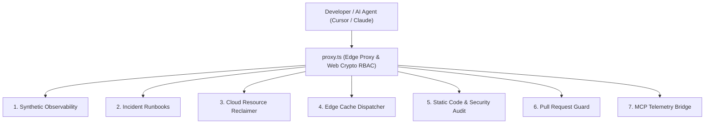

# 🚀 NexPulse — Complete Feature Documentation & Operational Guide

> **System Operational Status**: `100% OPERATIONAL & LIVE`  
> **Framework & Engine**: Next.js 16.2.4 (Webpack / React 19) + Web Crypto Security Proxy  
> **Test Suite**: 99/99 Unit & Integration Tests Passing  

---

## 📋 Executive Overview

NexPulse is an enterprise-grade Infrastructure Observability & Resilience Console for modern web applications. It combines real-time synthetic monitoring, automated incident runbooks, cloud resource reclamation, edge cache dispatching, pre-merge pull request security guards, and native MCP developer tooling.

---

## 🛠️ Feature Breakdown, Analogies & Live Status

---

### 1. 📡 Synthetic Observability & Real-Time Monitoring

* **What it does**: Tracks HTTP/HTTPS service availability, response latencies (p95/p99), status code histories, and SLA health checks in real time. Features background cron execution for automated interval polling.
* **💡 Real-World Analogy**: Like an **ICU Telemetry Monitor** in a hospital. It constantly measures the heartbeat (latency and HTTP status) of your web application. If an irregularity occurs, it alerts engineers immediately before users notice.
* **Technical Endpoints**:
  * `GET /api/health` — System pulse check
  * `POST /api/cron/monitor` — Cron monitoring pipeline (secured via `CRON_SECRET` & API Keys)
* **🟢 Live Status**: **Fully Operational**

---

### 2. 🤖 Automated Incident Runbooks & Anomaly Remediation

* **What it does**: Monitors system metrics for telemetry anomalies (e.g. p95 latency spikes, connection pool exhaustion). Correlates telemetry events directly with Git deployment commits, calculates diagnosis confidence, and executes pre-approved zero-downtime rollbacks or interactive triage recommendations.
* **💡 Real-World Analogy**: Like **Full Self-Driving with Automatic Emergency Braking**. If an obstacle (memory leak or bad SQL query) suddenly appears, the system detects it, identifies which recent repair (commit `#a83f21`) caused it, and executes the remediation plan before an outage occurs.
* **Technical Endpoints**:
  * `GET /api/autopilot/incidents` — List active telemetry anomalies
  * `POST /api/autopilot/incidents` — Simulate/create incidents
  * `PATCH /api/autopilot/incidents` — Execute remediation or rollback
* **🟢 Live Status**: **Fully Operational**

---

### 3. 💸 Cloud Resource Reclaimer & FinOps

* **What it does**: Scans connected multi-cloud infrastructure (Supabase PostgreSQL replicas, unattached AWS EBS volumes, idle Vercel Blob buckets). Detects unattached orphaned resources bleeding monthly budget and provides 1-click single-action termination. Also tracks historical recovered cost.
* **💡 Real-World Analogy**: Like a **Smart Facility Energy Auditor**. It inspects your cloud infrastructure, discovers servers or volumes running in empty, abandoned environments, and allows you to decommission them with a single click to immediately stop budget waste.
* **Technical Endpoints**:
  * `GET /api/finops/resources` — Scan idle and orphaned cloud infrastructure
  * `POST /api/finops/cleanup` — Decommission resource & reclaim budget
* **🟢 Live Status**: **Fully Operational** (Provides distinct views for *Cost Intelligence* spend analytics and *Resource Reclaimer* cleanup).

---

### 4. ⚡ Edge Cache Dispatcher (Surgical Revalidation)

* **What it does**: Instantly invalidates Next.js and CDN caches globally by tag or path across edge locations within milliseconds—without requiring full site rebuilds or redeployments.
* **💡 Real-World Analogy**: Like **erasing a single typo on a digital billboard using a laser pointer** rather than tearing down the entire structure and printing a new vinyl banner from scratch.
* **Technical Endpoints**:
  * `POST /api/revalidate` — Surgical tag/path cache invalidation (requires Bearer API key)
* **🟢 Live Status**: **Fully Operational**

---

### 5. 🧠 Static Analysis & Security Audit

* **What it does**: Deep security, SEO, Core Web Vitals, and code architecture audit engine. Supports GitHub repository links, uploaded `.zip` source archives, or pasted code snippets. Streams real-time Server-Sent Events (SSE) logs during evaluation and scores code quality from 0–100.
* **💡 Real-World Analogy**: Like a **Comprehensive Engineering Inspection** for your codebase. It parses project structure, discovers architectural weaknesses, security vulnerabilities (exposed secrets, unvalidated inputs), and produces an actionable remediation report.
* **Technical Endpoints**:
  * `POST /api/code-review` — Initiate SSE code audit stream
  * `DELETE /api/code-review/[id]` — Remove audit records
  * `POST /api/analyze` — Website SEO & performance analysis
* **🟢 Live Status**: **Fully Operational**

---

### 6. 🐙 Pull Request Guard

* **What it does**: Listens to incoming GitHub Pull Request webhooks (`pull_request.opened`, `synchronize`). Automatically analyzes code changes, checks Core Web Vitals impact, verifies dependency security, and posts an automated review score comment directly on the GitHub PR thread.
* **💡 Real-World Analogy**: Like a **Senior Staff Security Reviewer** who automatically inspects every single pull request before merge, highlighting regressions and verifying adherence to best practices.
* **Technical Endpoints**:
  * `POST /api/webhooks/github-pr` — GitHub Webhook handler (verified via HMAC-SHA256 buffer comparison)
  * `GET / POST / PATCH / DELETE /api/pr-bot` — Repository webhook configuration
* **🟢 Live Status**: **Fully Operational**

---

### 7. 🔌 Model Context Protocol (MCP) Bridge

* **What it does**: Implements the standard JSON-RPC 2.0 Model Context Protocol. Allows IDE AI assistants (Cursor, Claude Desktop, Windsurf) to query real-time server health, fetch active incidents, trigger cache purges, and run SEO audits directly from the developer's local editor.
* **💡 Real-World Analogy**: Like giving your AI coding assistant a **Direct Telemetry Feed to Production**. While writing code in Cursor, your assistant can query live latency data and incident history in real time.
* **Technical Endpoints**:
  * `POST /api/mcp` — JSON-RPC 2.0 endpoint (SSRF-protected)
* **🟢 Live Status**: **Fully Operational**

---

### 8. 🛡️ Web Crypto Edge Security & RBAC Proxy (`proxy.ts`)

* **What it does**: Next.js 16 standard Edge proxy enforcing HMAC-SHA256 JWT signature verification using the native Web Crypto API, Role-Based Access Control (RBAC), CORS headers, and rate limiting.
* **💡 Real-World Analogy**: Like **Airport Security with Biometric Verification**. Every incoming request must present valid cryptographically signed credentials before accessing protected routes.
* **Location**: `proxy.ts`
* **🟢 Live Status**: **Fully Operational**

---

## 📊 Summary Feature Matrix

| Feature | Primary Purpose | Key Benefit | Status |
| :--- | :--- | :--- | :---: |
| **Synthetic Observability** | HTTP Uptime & Latency Polling | Prevents unnoticed downtime | 🟢 Live |
| **Automated Incident Runbooks** | Anomaly correlation & rollback execution | Resolves outages in seconds | 🟢 Live |
| **Cloud Resource Reclaimer** | Orphaned cloud resource cleanup & savings | Eliminates monthly cloud waste | 🟢 Live |
| **Edge Cache Dispatcher** | Global edge cache purging by tag/path | Instant content updates across PoPs | 🟢 Live |
| **Static Code Audit** | SSE-streamed static analysis & SEO scan | Higher code quality & security | 🟢 Live |
| **Pull Request Guard** | Automated PR audit comments on GitHub | Prevents defects from reaching main | 🟢 Live |
| **MCP Bridge** | Direct AI agent integration (Cursor/Claude) | Context-aware AI code generation | 🟢 Live |
| **Security Proxy** | Edge JWT HMAC & RBAC protection | Complete architectural protection | 🟢 Live |

---

## 🔒 Verification & Quality Assurance Summary

* **Branch Status**: `main` is synchronized on GitHub.
* **TypeScript Compilation**: Clean (`0` errors).
* **Unit & Integration Testing**: All **99 tests passing** across security, RBAC, SEO, MCP, and incident modules.
* **Theme & UI**: Engineered with Plus Jakarta Sans typography, custom micro-depth dark/light tokens, and hardware-precision iconography.
